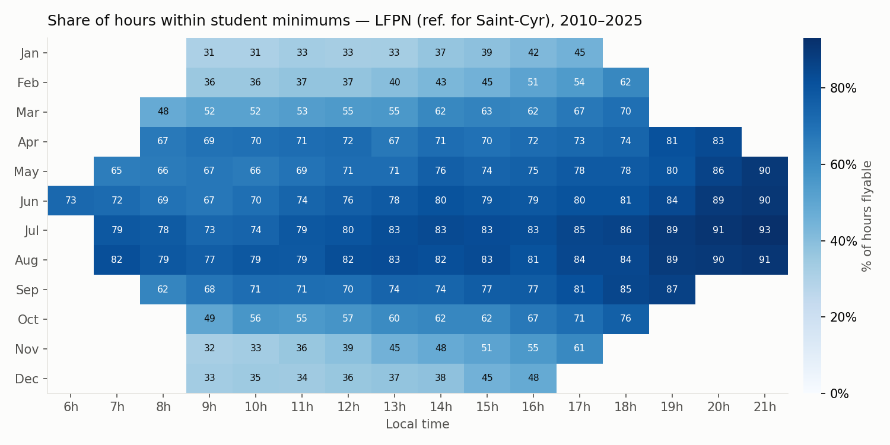
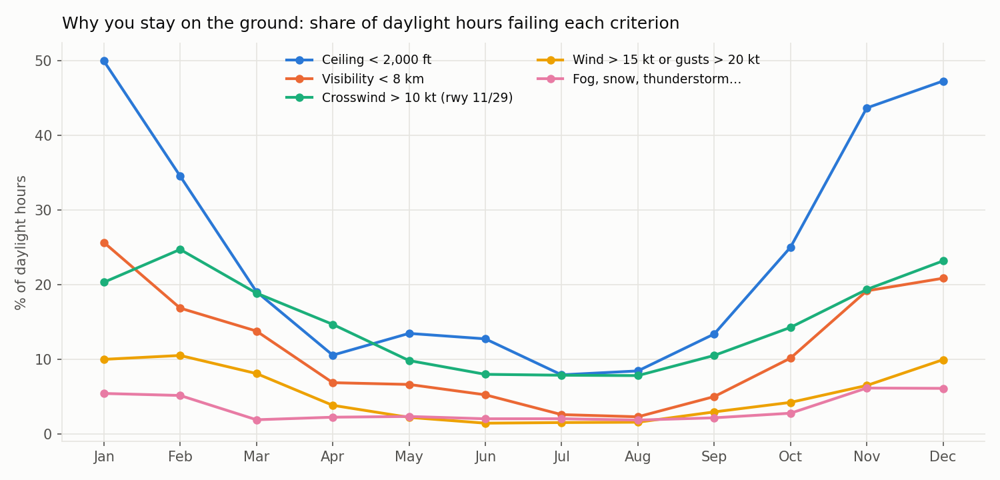
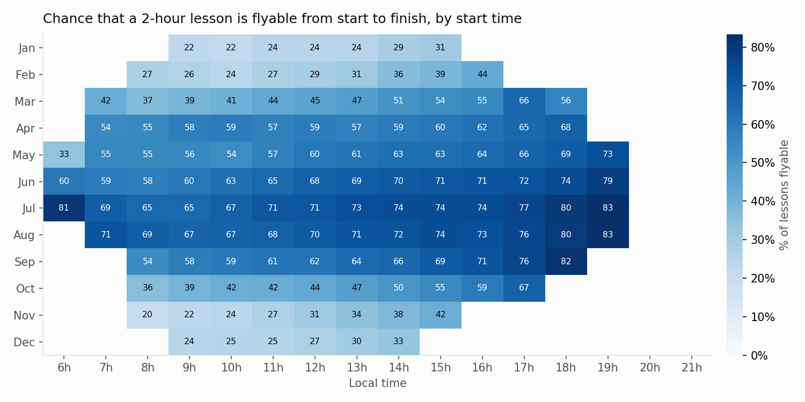
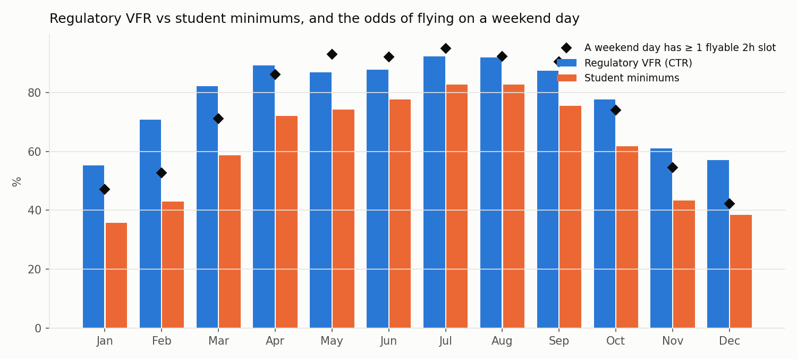
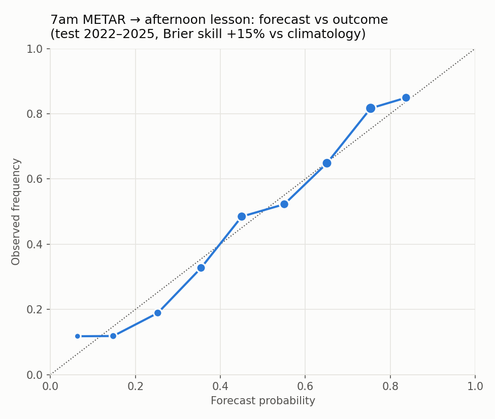
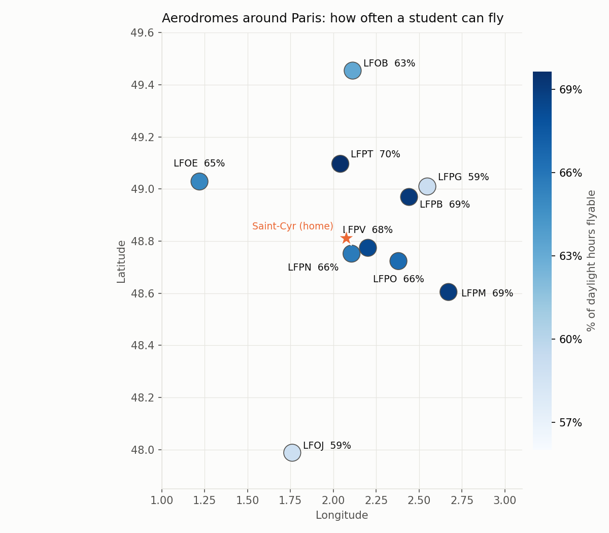

# When can a student pilot fly from Saint-Cyr? — VFR climatology from 15 years of METARs

I am learning to fly (PPL) at Saint-Cyr-l'École (LFPZ). Every lesson is booked days in advance, and many are cancelled
for weather. This project turns 15 years of aviation weather reports (METAR) into practical answers:

- **When** in the year and in the day is a lesson most likely to go ahead?
- **Why** do lessons get cancelled: low cloud, poor visibility, wind, crosswind, fog?
- **How likely** is a 2-hour slot to be flyable from start to finish, and what are the odds on a weekend day?
- **Can the 7am METAR predict** whether the afternoon lesson will fly, better than climatology?
- **Where**: how do the aerodromes around Paris compare (interactive map)?

<!-- RESULTS:START -->
## Results (LFPN, 2010-2025, 69,948 daylight hours)



- **66% of daylight hours** meet the student minimums (81% meet regulatory VFR).
  Best month: **Jul** (83%), worst: **Jan** (36%).
- **Chance that a given weekend day offers at least one flyable 2-hour slot**: 92% in June,
  42% in December.
- **Best 2-hour lesson start by month**: Jan 15h (31%), Feb 16h (44%), Mar 17h (66%), Apr 18h (68%), May 19h (74%), Jun 19h (78%), Jul 19h (83%), Aug 19h (83%), Sep 18h (82%), Oct 17h (67%), Nov 15h (42%), Dec 14h (33%).
- **Main reason to stay on the ground**, by month: Jan ceiling, Feb ceiling, Mar ceiling, Apr crosswind, May ceiling, Jun ceiling, Jul ceiling, Aug ceiling, Sep ceiling, Oct ceiling, Nov ceiling, Dec ceiling.





### Can the 7am METAR predict a 14h–16h lesson?

Logistic regression on the 7am observation (visibility, ceiling, wind, temperature–dew point spread, fog, precipitation,
season), trained 2010-2021 and tested out of sample on 2022-2025 (1459 days):
**Brier skill +15%** against monthly climatology, AUC 0.79.
With fog or mist at 7am, the afternoon lesson was flyable 46% of the time,
against 55% otherwise.



### Map



Interactive version: [`docs/index.html`](docs/index.html) (can be served with GitHub Pages).
<!-- RESULTS:END -->

## Method

**Data.** METAR archives from the Iowa Environmental Mesonet. Saint-Cyr has no METAR, so **Toussus-le-Noble (LFPN)**,
8 km away, is the reference station (2010–2025). Nine other aerodromes around Paris (2018–2025) are used for the map.

**Decoding.** A small METAR decoder written for this project (`src/metar.py`, unit-tested on typical reports):
wind and gusts, visibility (including CAVOK), ceiling = lowest broken / overcast layer or vertical visibility,
weather phenomena (fog, mist, rain, snow, thunderstorm), CB, temperature and dew point. Trends (TEMPO, BECMG)
are ignored: only the observation counts.

**Hourly grid.** For each hour, the latest METAR at or before it (at most 90 minutes old). Daylight is computed from the
sun's elevation, since a student flies by day only.

**Criteria** (`src/flying.py`, easy to change):

| | Student minimums | Regulatory VFR (control zone) |
|---|---|---|
| Visibility | ≥ 8 km | ≥ 5 km |
| Ceiling | ≥ 2,000 ft | ≥ 1,500 ft |
| Wind / gusts | ≤ 15 kt / ≤ 20 kt | — |
| Crosswind on runway 11/29 | ≤ 10 kt (gusts included) | — |
| Weather | no fog, snow, freezing precipitation, hail, thunderstorm, heavy precipitation | no fog, no thunderstorm |

The student minimums are a conservative example, not an official rule: each pilot sets them with their instructor.

**Lesson slots.** A 2-hour lesson starting at hour *h* is flyable if the observations at *h*, *h*+1 and *h*+2 all meet
the criteria and the lesson ends before sunset.

**Forecast.** For each day, a logistic regression uses the 7am METAR (visibility, ceiling, wind, gusts,
temperature–dew point spread, fog or mist, precipitation, season) to predict whether a 14h–16h lesson will fly.
Trained on 2010–2021, **tested out of sample on 2022–2025**, and compared with the monthly climatology through the
Brier score and a reliability diagram.

## Validation (`pytest`, 11 tests)

- METAR decoder on typical reports: CAVOK, fog with vertical visibility, multiple layers, thunderstorm with CB,
  ignored trends, negative temperatures, winds in m/s
- Solar elevation in Paris at the solstices, crosswind geometry on runway 11/29
- Criteria flags, 2-hour slot logic, and the seasonal cycle on synthetic METARs

## Limitations

- **Toussus is not Saint-Cyr**: close, but local effects (fog in the valley, wind channelling) can differ
- A METAR is a point observation every 30 minutes: weather between reports, or along the route, is not seen
- Minimums simplified: no density altitude, no turbulence, no instructor judgement
- The forecast uses a single morning report; a real decision would also use the TAF and the forecast charts

## Run it

```bash
pip install -r requirements.txt
python run.py              # downloads the METAR archives once (a few minutes), writes figures/, docs/ and results.json
python run.py --synthetic  # offline, on synthetic METARs
python -m pytest -q
```

Or open `notebooks/vfr_climatology.ipynb` in Google Colab.

Data: [Iowa Environmental Mesonet](https://mesonet.agron.iastate.edu/request/download.phtml) METAR archive.
This is a statistical study, **not a tool for flight decisions**: always use the official weather briefing.

## Structure

```
src/metar.py     METAR decoder
src/data.py      aerodromes, archive download and cache, synthetic METARs
src/flying.py    daylight, criteria, crosswind, hourly grid, slots, morning forecast
src/mapping.py   interactive Leaflet map
run.py           full pipeline: figures, docs/index.html, results.json
tests/           decoder and pipeline tests
```
